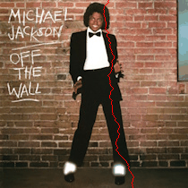

# Seam Carving Tutorial

**Team 06**

ECE572: Nick Ashmore, Elias Tessema

ECE472: Christian Spicher, Henry Hill, Jasmine Huynh

<p align="center">
  
  <br>
  <em>Each red line is the lowest-energy seam at that step. It is removed, and the image gets one pixel narrower.</em>
</p>

## What is seam carving?

Seam carving is a content-aware technique to resize an image. Each pixel first gets an **energy** score for how "important" it is [1]. A **seam** is a connected path one pixel wide that runs from one edge of the image to the opposite edge. A vertical seam takes exactly one pixel per row, and its column can shift by at most one between neighboring rows.

In this tutorial, that score is the gradient magnitude from a Sobel filter (`|Gx| + |Gy|` on the grayscale image), so edges and texture score high and flat areas like sky score low. **Dynamic programming** finds the seam with the lowest total energy. It builds a cumulative energy map `M` whose first row is copied from the energy map, and each later cell adds its own energy to the smallest of the three cells above it (up-left, up, up-right). The smallest value in the bottom row marks where the cheapest seam ends, and backtracking upward through the smallest neighbors recovers the whole seam. Removing that seam shrinks the image by one column. Repeating the process (recompute energy, find the seam, remove it) reaches the target width while keeping the main objects in proportion.

The method can still leave artifacts when no low-energy path exists. This tutorial covers seam removal only, using the original backward-energy method. It does *not* use the [forward-energy improvement](https://avikdas.com/2019/07/29/improved-seam-carving-with-forward-energy.html), which scores the new edges a removal would create [2].

### The algorithm in four steps

1. **Calculate energy:** run a Sobel filter over the grayscale image.
2. **Find the lowest-energy seam:** build the cumulative map `M` with dynamic programming, then backtrack.
3. **Remove the seam:** mask out one pixel per row and reshape to `cols - 1`.
4. **Repeat** until the image reaches the size you want.

## Visual walkthrough (the 5×5 practice problem)

### 1. Energy map `E`

Every number is one pixel's energy. A high value means an edge or detail to keep, and a low value means a pixel that can safely go.

```
      c0  c1  c2  c3  c4
r0  [  7,  3,  5,  8,  6 ]
r1  [  6,  4,  2,  5,  7 ]
r2  [  8,  3,  5,  2,  6 ]
r3  [  7,  5,  3,  4,  8 ]
r4  [  6,  2,  4,  5,  7 ]
```

### 2. Cumulative energy map `M`

Row 0 of `M` is copied straight from `E`. After that, each cell looks at the three cells above it and adds the smallest one to its own energy:

```
        M[i-1, j-1]   M[i-1, j]   M[i-1, j+1]
                 ↘        ↓        ↙
                        M[i, j]

M[i, j] = E[i, j] + min(M[i-1, j-1], M[i-1, j], M[i-1, j+1])
```

Edge columns have only two neighbors above them. For example, `M[1,0] = 6 + min(7, 3) = 9` and `M[1,2] = 2 + min(3, 5, 8) = 5`. Filling every row gives:

```
      c0  c1  c2  c3  c4
r0  [  7,  3,  5,  8,  6 ]
r1  [  9,  7,  5, 10, 13 ]
r2  [ 15,  8, 10,  7, 16 ]
r3  [ 15, 13, 10, 11, 15 ]
r4  [ 19, 12, 14, 15, 18 ] ← smallest value = 12, at column 1
```

Each cell of `M` answers one question: what is the cheapest way to reach this pixel from anywhere in the top row?

### 3. Backtrack to get the seams

Start at the smallest value in the bottom row (`12`, column 1). Then move up one row at a time to whichever of the three cells above has the smallest `M`:

| Row | Cell `M` chosen | Column | Pixel energy `E` |
| :-: | :---------------: | :----: | :----------------: |
| r4 |        12        |   1   |         2         |
| r3 |        10        |   2   |         3         |
| r2 |         7         |   3   |         2         |
| r1 |         5         |   2   |         2         |
| r0 |         3         |   1   |         3         |

The minimum seam is columns **[1, 2, 3, 2, 1]** from top to bottom, and its total energy is 3 + 2 + 2 + 3 + 2 = **12**. Marked on `E` it looks like this:

```
r0  [  7, (3),  5,  8,  6 ]
r1  [  6,  4, (2),  5,  7 ]
r2  [  8,  3,  5, (2),  6 ]
r3  [  7,  5, (3),  4,  8 ]
r4  [  6, (2),  4,  5,  7 ]
```

### 4. Remove the seam

Delete the circled pixel from each row and the 5×5 map becomes 5×4. On a real image this is one step of the GIF above: the red line is drawn, then removed. Repeat for as many columns as you want to cut.

## Repository layout

```
tutorial/
├── seam_carving_student.ipynb     # Student version: fill in the #TODO lines in Section 4
├── seam_carving_solution.ipynb     # Complete, working version
├── seam_carving_solutions.txt      # The exact #TODO solutions
├── images/            				# Input images used by the notebooks
└── *.gif              				# Seam-removal animations
seam_carving_slides.pdf / .pptx   	# Presentation slides
```

## Requirements

- Python 3.9+
- Jupyter (Notebook, JupyterLab, or the VS Code Jupyter extension)
- Packages: `numpy`, `scipy`, `matplotlib`, `scikit-image`, `imageio`, `tqdm`

## Installation

```bash
git clone https://github.com/NickAshmore/Seam-Carving-Tutorial.git
cd Seam-Carving-Tutorial

# (optional) create a virtual environment
python3 -m venv .venv
source .venv/bin/activate    # Windows: .venv\Scripts\activate

pip install numpy scipy matplotlib scikit-image imageio tqdm jupyter
```

## Running the notebooks

The notebooks load images with relative paths such as `images/field.jpg`, so start Jupyter from inside the `tutorial/` folder:

```bash
cd tutorial
jupyter notebook      # or: jupyter lab
```

- **`seam_carving_tutorial.ipynb`** is the one to work through. Run the cells from top to bottom. Sections 1–3 explain and demonstrate seam carving. Section 4 is the 5×5 practice problem, with `#TODO` lines for you to fill in.
- **`seam_carving_solution.ipynb`** is the completed version. Use it to compare your output, or to see the full pipeline run on all the sample images.

> **Stuck?** Check [`tutorial/seam_carving_solutions.txt`](tutorial/seam_carving_solutions.txt)for the `#TODO` solutions.

## References

[1] S. Avidan and A. Shamir, "Seam carving for content-aware image resizing," in *ACM SIGGRAPH 2007 Papers*, San Diego, CA, USA, 2007, Art. no. 10, doi: 10.1145/1275808.1276390.

[2] A. Das, "Improved seam carving with forward energy," *Avik Das*, Jul. 29, 2019. [Online]. Available: https://avikdas.com/2019/07/29/improved-seam-carving-with-forward-energy.html
